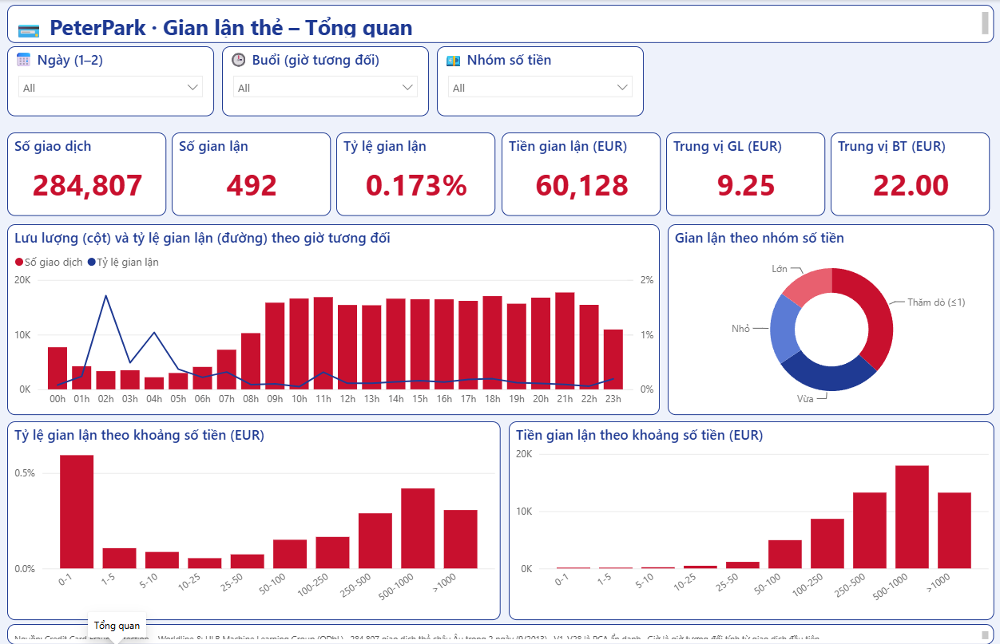
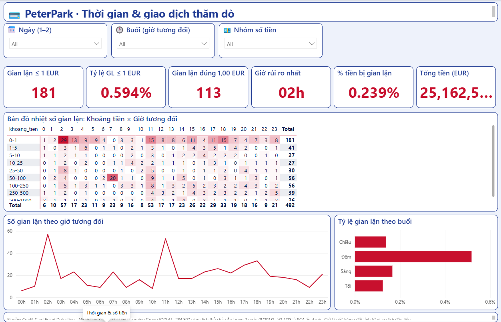
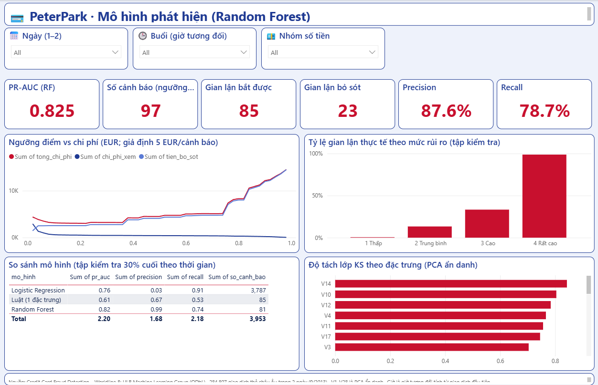
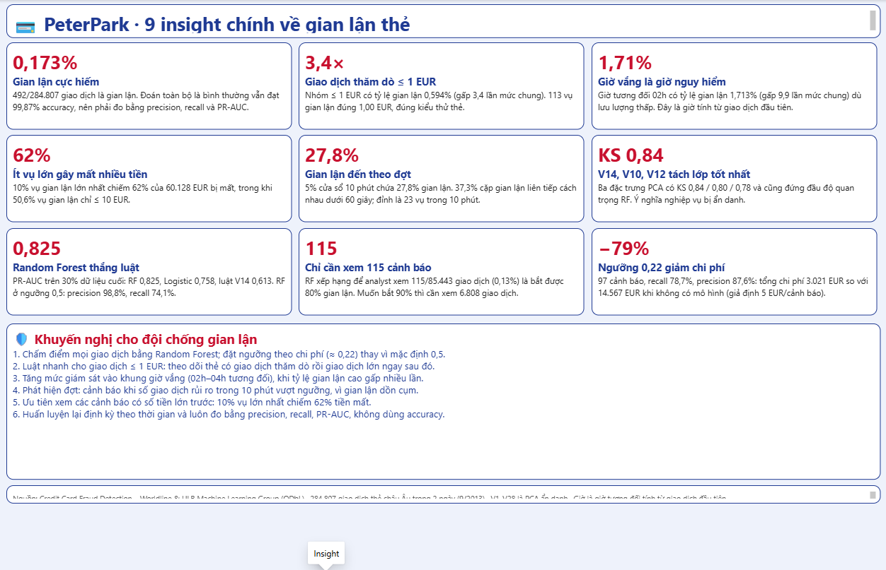

# 💳 Phát hiện gian lận thẻ tín dụng · Credit Card Fraud Detection

**VI:** Phân tích 284.807 giao dịch thẻ (2 ngày, 9/2013) bằng Python, SQL và Power BI: tìm dấu hiệu gian lận, so sánh luật đơn giản với Logistic Regression và Random Forest, rồi tính analyst cần xem bao nhiêu cảnh báo và đặt ngưỡng theo chi phí.
**EN:** Fraud analytics on 284,807 card transactions with Python, SQL and Power BI: fraud patterns, rule baseline vs Logistic Regression vs Random Forest, alert-review workload and a cost-based threshold.

Tác giả: **Nguyễn Văn Tùng (PeterPark)**



## 🔎 Insight chính (mọi số liệu lấy từ output notebook)

| # | Insight | Số liệu |
|---|---|---|
| 1 | Gian lận cực hiếm → accuracy vô nghĩa | 492/284.807 = **0,173%**; đoán toàn bộ "bình thường" vẫn đạt 99,87% accuracy trên tập kiểm tra |
| 2 | Giao dịch thăm dò (card testing) | Nhóm ≤ 1 EUR có tỷ lệ gian lận **0,594%** (gấp 3,4 lần); 113 vụ gian lận đúng 1,00 EUR; 181 vụ (36,8%) ≤ 1 EUR |
| 3 | Giờ vắng nguy hiểm nhất | Giờ tương đối 02h: **1,713%** gian lận (gấp 9,9 lần mức chung) |
| 4 | Ít vụ lớn gây mất nhiều tiền | 10% vụ lớn nhất = **62%** của 60.127,97 EUR bị mất; 50,6% vụ gian lận ≤ 10 EUR; trung vị 9,25 EUR (bình thường 22,00 EUR) |
| 5 | Gian lận đến theo đợt | 5% cửa sổ 10 phút chứa **27,8%** gian lận; 37,3% cặp liên tiếp cách nhau < 60 giây; đỉnh 23 vụ/10 phút |
| 6 | Đặc trưng tách lớp tốt nhất | V14, V10, V12 với KS **0,84 / 0,80 / 0,78** (PCA ẩn danh nên không diễn giải được nghiệp vụ) |
| 7 | Random Forest thắng | PR-AUC: RF **0,825**, Logistic 0,758, luật V14 0,613. RF @0,5: precision 98,8%, recall 74,1% |
| 8 | Khối lượng việc của analyst | Với RF, xem **115**/85.443 giao dịch (0,13%) là bắt 80% gian lận; top 0,1% bắt 75,9% (lift 759×); muốn 90% thì cần xem 6.808 |
| 9 | Ngưỡng theo chi phí | Ngưỡng 0,22: 97 cảnh báo, recall 78,7%, precision 87,6%; tổng chi phí 3.021 EUR so với 14.567 EUR khi không có mô hình (**−79,3%**, giả định 5 EUR cho mỗi cảnh báo) |

Ngoài ra: 2 ngày có tỷ lệ 0,194% và 0,151%; có 1.081 dòng trùng lặp, được giữ nguyên như bản gốc.

## 📊 Dashboard Power BI (4 trang, có slicer Ngày / Buổi / Nhóm số tiền)

| Thời gian & số tiền | Mô hình |
|---|---|
|  |  |



## 🧠 Phương pháp
- **Chia theo thời gian:** 70% đầu để huấn luyện (384 vụ gian lận), 30% cuối để kiểm tra (108 vụ), không xáo trộn nên không rò rỉ tương lai.
- **Mất cân bằng lớp:** `class_weight='balanced'` / `balanced_subsample`; đo bằng precision, recall, PR-AUC (accuracy chỉ để tham khảo).
- **Baseline luật:** `V14 < -5,844`, ngưỡng tối ưu F1 trên tập train.
- **Mô hình:** Logistic Regression (chuẩn hóa) và Random Forest (300 cây). Đặc trưng: V1..V28, log(Amount), giờ.
- **Lift/gains** và **ngưỡng theo chi phí:** chi phí = 5 EUR × số cảnh báo + tiền gian lận bị bỏ sót.

## 📁 Cấu trúc
```
phan_tich_gian_lan_the.ipynb   # notebook (giải thích tiếng Việt)
download_data.py               # tải dữ liệu gốc ~150 MB
data/creditcard_sample_2k.csv  # mẫu phân tầng 2.000 dòng, giữ tỷ lệ gian lận (3 vụ); notebook cần bản đầy đủ
sql/                           # 10 truy vấn SQLite
charts/                        # 13 biểu đồ
powerbi/                       # CSV cho Power BI + theme + dashboard PBIP
HUONG_DAN_POWER_BI.md
```

## ▶️ Cách chạy
```bash
py -m pip install -r requirements.txt     # Windows (python -m pip trên macOS/Linux)
py download_data.py                        # tải data/creditcard.csv
py -m jupyter nbconvert --to notebook --execute --inplace phan_tich_gian_lan_the.ipynb
```
Mở `powerbi/dashboard/PeterPark_Gian_Lan_The.pbip`: xem [HUONG_DAN_POWER_BI.md](HUONG_DAN_POWER_BI.md).

## ⚠️ Hạn chế
- `V1..V28` là thành phần **PCA đã ẩn danh**: không có merchant, quốc gia hay thiết bị, nên không diễn giải được ý nghĩa nghiệp vụ.
- Chỉ có **2 ngày** dữ liệu; "giờ" là giờ tương đối tính từ giao dịch đầu tiên, không phải giờ địa phương.
- Chi phí 5 EUR cho mỗi cảnh báo là giả định minh họa. Tập kiểm tra chỉ có 108 vụ gian lận nên các tỷ lệ còn dao động.

## 🙏 Credits
Dữ liệu: *Credit Card Fraud Detection*, Worldline và Machine Learning Group, Université Libre de Bruxelles (ULB), giấy phép [ODbL](https://opendatacommons.org/licenses/odbl/1-0/). Bản tải từ mirror công khai của TensorFlow.
Dal Pozzolo, A., Caelen, O., Johnson, R. A., Bontempi, G. (2015). *Calibrating Probability with Undersampling for Unbalanced Classification.* IEEE SSCI.
